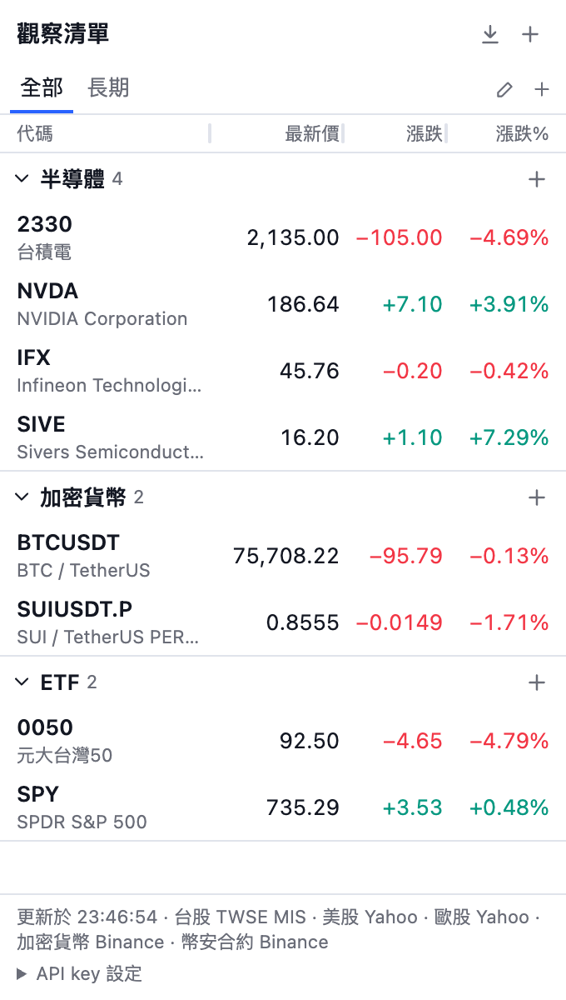
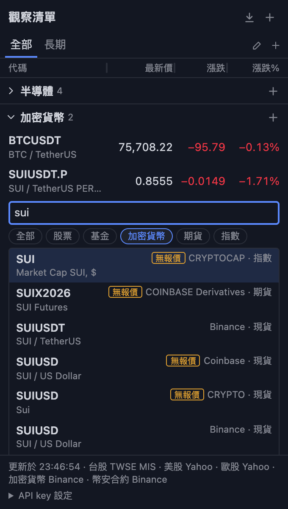

# MultiList for TradingView

[English](README.md) | [繁體中文](README.zh-TW.md)

A Chrome side panel watchlist for people who chart on TradingView. Create as many groups as you want, and put the same symbol in as many groups as you want. Click a symbol to show it on your TradingView chart.

<p>
  
  
</p>

This is an independent personal project. It is not affiliated with TradingView.

The interface is in Traditional Chinese.

## Features

- Unlimited groups. A symbol can be in many groups.
- Search by code or by company name, in English or Chinese. The results come from TradingView search, with all exchanges, spot pairs, perpetual contracts and futures.
- Import your TradingView watchlists with one click. Each list becomes a tab, and each section becomes a group.
- Prices for Taiwan stocks (TWSE, TPEx), US stocks, European stocks, Binance spot pairs and Binance perpetual contracts. You can also add other symbols, for example other exchanges, futures, indices or forex. They show no price, but a click still opens the chart.
- The **All** tab shows every group. A new install also has one custom tab, **分頁1**. Add more tabs with the **+** at the right end of the tab bar. You decide which groups go in each tab. A custom tab shows only its own groups, and these groups also show on **All**.
- Click the pencil at the right end of the tab bar to rename the current tab. Clear the name of **All** to go back to the default. A custom tab also has a delete button while you edit it. Its groups stay on **All**.
- Drag a group header onto a tab to move the group there. Drop it on **All** to take it out of its custom tab.
- Drag the lines in the column header to change the column widths. A column cannot get narrower than its widest number. Double-click a line to go back to the default widths. Widths stay on this computer.
- Last price, change and change percent. Open groups on the current tab refresh every 30 seconds.
- Click a row to switch the chart in your TradingView tab.
- Drag to reorder symbols and groups, or to move a symbol to another group.
- Groups and tabs sync through your Chrome account. No server is needed.

## Install

1. Download or clone this repository.
2. Open `chrome://extensions` in Chrome.
3. Turn on **Developer mode**.
4. Click **Load unpacked**, then select the `extension` folder.
5. Pin the extension, then click its icon to open the side panel.

The extension needs Chrome 117 or later.

## Use

1. Click **新增分組** (new group) at the top of the list to create a group.
2. Type a code or a name, for example `2330`, `台積電`, `AAPL` or `SUI`. Results from TradingView show below the box. Use the filter buttons to show one kind only, for example crypto.
3. Click a result, or press ↑ or ↓ to mark one and press Enter. A result marked **無報價** has no price source, but you can still add it.
4. Click a row to open it on the chart.
5. Press Esc to close the input box.

The search needs an open TradingView tab in Chrome. Without one, type full codes and press Enter. You can type several at once, for example `2330 AAPL IFX BTCUSDT`. Numeric codes are looked up as Taiwan stocks. Other tickers are looked up as US stocks first, then as European stocks. You can also type the full form, for example `NYSE:TSM`, `XETR:IFX` or `BINANCE:SUIUSDT.P`.

For a European stock that has the same ticker as a US stock, type the exchange. Use the TradingView form, for example `XETR:SAP`, or the Yahoo form, for example `SAP.DE`.

European stocks have prices on these exchanges:

| Exchange | TradingView | Yahoo |
| --- | --- | --- |
| Xetra | `XETR:IFX` | `IFX.DE` |
| London | `LSE:IQE` | `IQE.L` |
| Euronext (Paris, Amsterdam, Brussels, Lisbon, Dublin) | `EURONEXT:ASML` | `ASML.AS` |
| Milan | `MIL:ENEL` | `ENEL.MI` |
| Madrid | `BME:SAN` | `SAN.MC` |
| SIX Swiss | `SIX:NESN` | `NESN.SW` |
| Stockholm | `OMXSTO:SIVE` | `SIVE.ST` |
| Copenhagen | `OMXCOP:NOVO_B` | `NOVO-B.CO` |
| Helsinki | `OMXHEX:NOKIA` | `NOKIA.HE` |
| Oslo | `OSL:EQNR` | `EQNR.OL` |
| Vienna | `VIE:OMV` | `OMV.VI` |
| Warsaw | `GPW:PKO` | `PKO.WA` |

## Import TradingView watchlists

1. Open TradingView in Chrome and sign in.
2. Click the download arrow at the top of the panel.
3. Select the lists to import, then click **匯入**.

Each list becomes a new tab. Each `###` section of a list becomes a group in that tab. Symbols before the first section go to a group with the name of the list. The import looks up the names of Taiwan, US and European stocks, so a long list can take some seconds.

Chrome sync allows 8 KB for each group (about 150 symbols) and 100 KB in total. If the import does not fit, it stops before it saves anything and shows the reason. An import always adds new tabs. It does not update tabs from an earlier import.

## Data sources

| Market | Used if you add a key | Used without a key |
| --- | --- | --- |
| Taiwan stocks | [Fugle](https://developer.fugle.tw/docs/pricing) | TWSE MIS |
| US stocks | [Alpaca](https://docs.alpaca.markets/docs/about-market-data-api) (IEX only) | Yahoo Finance |
| European stocks | Not available | Yahoo Finance |
| Crypto | Not needed | Binance |
| Binance perpetual contracts | Not needed | Binance futures API |

Add keys under **API key settings** at the bottom of the panel. Keys stay on your computer and do not sync. If a keyed source fails, the panel uses the source without a key and shows the error.

TWSE MIS and Yahoo Finance are not documented public APIs. They can change or block requests at any time, and the Yahoo terms restrict automated access. Add keys if you want documented sources. A code that you type, and an imported symbol, use Yahoo or TWSE MIS to find the exchange and the name. A European search result uses Yahoo to find its Yahoo ticker.

The search and the import use TradingView. See the limits below.

## Limits

- A symbol change uses the symbol search on the TradingView page. The page does not reload, so unsaved chart changes stay.
- If TradingView changes that page, the extension reloads the page with the new symbol and shows a notice in the panel. A reload can lose unsaved chart changes.
- A free TradingView account still allows 2 indicators per chart.
- The search and the import call internal TradingView endpoints from your TradingView tab. These endpoints are not documented, and TradingView can change or block them at any time.
- Section 12 of the TradingView terms prohibits access through internal or undocumented endpoints, and the distribution of browser extensions that do this. The extension also controls the TradingView page when you click a symbol. Use this project at your own risk. It is for personal use. Read the terms before you use or share it.
- The import runs in your TradingView tab with your own sign-in. The extension never reads your password or your cookies.
- It works only in desktop browsers based on Chromium.
- Prices are for reference. Sources can be delayed or wrong.

## Develop

There is no build step. Reload the extension in `chrome://extensions` after a change.

```bash
npm test
```

The tests use the built-in Node.js test runner and need Node.js 22 or later.
