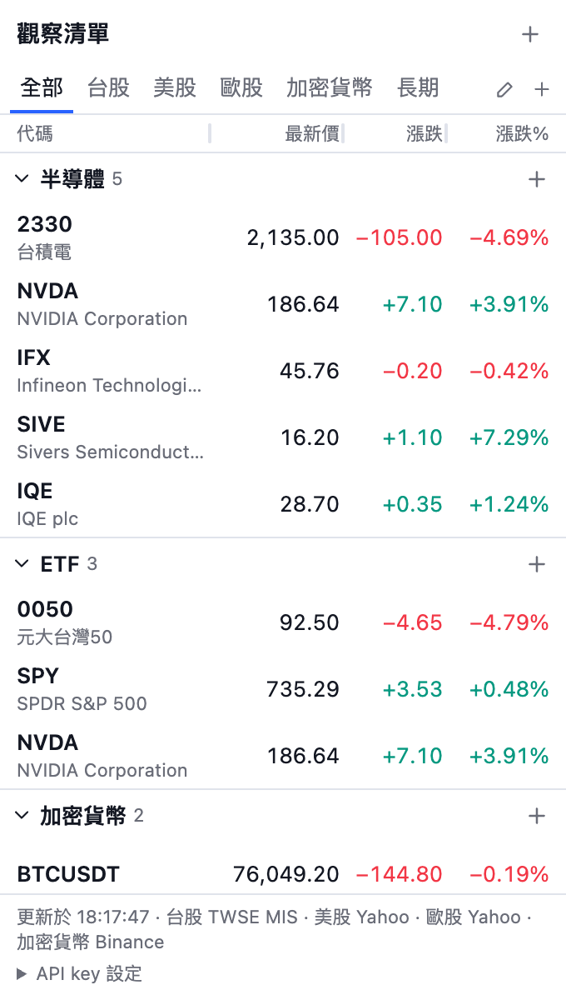
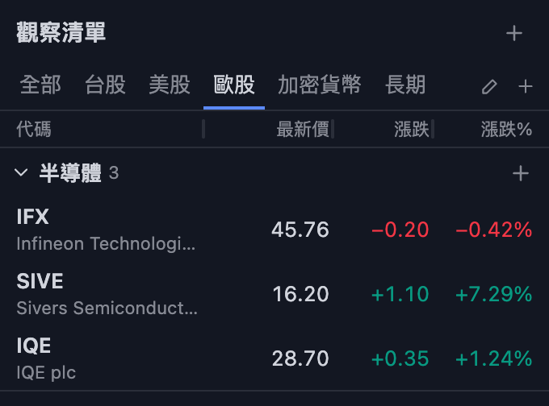

# MultiList for TradingView

[English](README.md) | [繁體中文](README.zh-TW.md)

這是給 TradingView 使用者的 Chrome 側邊欄觀察清單。你可以建立任意數量的分組，同一個代碼也可以放進多個分組。點選代碼，TradingView 圖表就會切換到該代碼。

<p>
  
  
</p>

這是獨立的個人專案，與 TradingView 沒有關係。

## 功能

- 分組數量沒有限制，同一個代碼可以放進多個分組。
- 支援台股（上市、上櫃）、美股、歐股、幣安交易對。
- 用分頁看全部、台股、美股、歐股、加密貨幣。每個代碼會自動歸到對應市場的分頁。
- 按分頁列右端的 **+** 可以新增自己的分頁。新分頁有自己的分組，這些分組也會出現在「全部」和各市場分頁。
- 按分頁列右端的鉛筆，可以重新命名目前的分頁。市場分頁清空名稱就會還原預設。編輯自訂分頁時也可以刪除它，裡面的分組會留在「全部」。
- 把分組標題拖到分頁上，可以把分組移到該分頁。拖到市場分頁，就會移出自訂分頁。
- 拖曳欄位標題上的分隔線可以調整欄寬。欄位不能窄於其中最寬的數字。在分隔線上按兩下會還原預設欄寬。欄寬只存在這台電腦。
- 顯示最新價、漲跌、漲跌幅。目前分頁中打開的分組每 30 秒更新一次。
- 點選一列，切換 TradingView 分頁的圖表。
- 拖曳可以調整代碼和分組的順序，也可以把代碼移到其他分組。
- 分組和分頁透過 Chrome 帳號同步，不需要伺服器。

## 安裝

1. 下載或 clone 這個 repo。
2. 在 Chrome 打開 `chrome://extensions`。
3. 開啟「開發人員模式」。
4. 按「載入未封裝項目」，選擇 `extension` 資料夾。
5. 把插件釘選到工具列，按圖示打開側邊欄。

插件需要 Chrome 117 以上。

## 使用

1. 按側邊欄上方的 **+**，建立分組。
2. 輸入代碼後按 Enter。可以一次輸入多個，例如 `2330 AAPL IFX BTCUSDT`。
3. 點選一列，在圖表上打開該代碼。
4. 按 Esc 關閉輸入框。

純數字代碼會當成台股查詢。其他代碼先查美股，查不到再查歐股。你也可以輸入完整格式，例如 `NYSE:TSM` 或 `XETR:IFX`。目前不支援指數、期貨、外匯。

如果歐股和美股的代碼相同，請加上交易所。可以用 TradingView 格式，例如 `XETR:SAP`，或 Yahoo 格式，例如 `SAP.DE`。

支援的歐洲交易所：

| 交易所 | TradingView | Yahoo |
| --- | --- | --- |
| Xetra（德國） | `XETR:IFX` | `IFX.DE` |
| 倫敦 | `LSE:IQE` | `IQE.L` |
| Euronext（巴黎、阿姆斯特丹、布魯塞爾、里斯本、都柏林） | `EURONEXT:ASML` | `ASML.AS` |
| 米蘭 | `MIL:ENEL` | `ENEL.MI` |
| 馬德里 | `BME:SAN` | `SAN.MC` |
| 瑞士 SIX | `SIX:NESN` | `NESN.SW` |
| 斯德哥爾摩 | `OMXSTO:SIVE` | `SIVE.ST` |
| 哥本哈根 | `OMXCOP:NOVO_B` | `NOVO-B.CO` |
| 赫爾辛基 | `OMXHEX:NOKIA` | `NOKIA.HE` |
| 奧斯陸 | `OSL:EQNR` | `EQNR.OL` |
| 維也納 | `VIE:OMV` | `OMV.VI` |
| 華沙 | `GPW:PKO` | `PKO.WA` |

## 資料來源

| 市場 | 有 key 時使用 | 沒有 key 時使用 |
| --- | --- | --- |
| 台股 | [Fugle](https://developer.fugle.tw/docs/pricing) | TWSE MIS |
| 美股 | [Alpaca](https://docs.alpaca.markets/docs/about-market-data-api)（只有 IEX） | Yahoo Finance |
| 歐股 | 無 | Yahoo Finance |
| 加密貨幣 | 不需要 | Binance |

在側邊欄底部的「API key 設定」輸入 key。Key 只存在這台電腦，不會同步。如果有 key 的來源失敗，側邊欄會改用沒有 key 的來源，並顯示錯誤訊息。

TWSE MIS 和 Yahoo Finance 不是有公開文件的 API。它們隨時可能變更或封鎖請求，Yahoo 條款也限制自動化存取。如果你要用有文件的來源，請加上 key。新增台股、美股或歐股代碼時，一律透過 TWSE MIS 或 Yahoo 查詢交易所和名稱。

## 限制

- 換代碼時，插件使用 TradingView 頁面上的代碼搜尋。頁面不會重新載入，所以未儲存的圖表變更會保留。
- 如果 TradingView 改版這個頁面，插件會改用新代碼重新載入頁面，並在側邊欄顯示提示。重新載入可能遺失未儲存的圖表變更。
- TradingView 免費帳號每張圖仍然只有 2 個指標。
- 插件不呼叫 TradingView 的內部端點，因為 TradingView 條款禁止這樣做。
- 點代碼時，插件會操作 TradingView 頁面。TradingView 條款第 12 條限制自動化存取和瀏覽器插件。這個專案供個人使用。分享之前請先閱讀條款。
- 只能用在 Chromium 系列的電腦版瀏覽器。
- 價格僅供參考，來源可能延遲或有誤。

## 開發

這個專案不需要 build。改完後到 `chrome://extensions` 重新載入插件。

```bash
npm test
```

測試使用 Node.js 內建的 test runner，需要 Node.js 22 以上。
